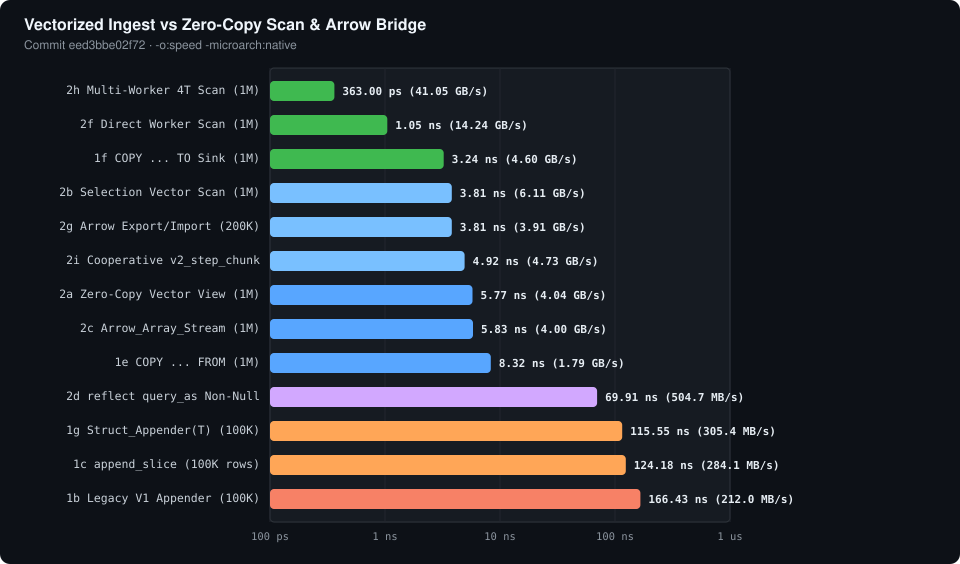
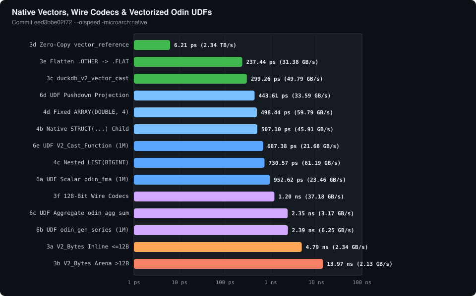
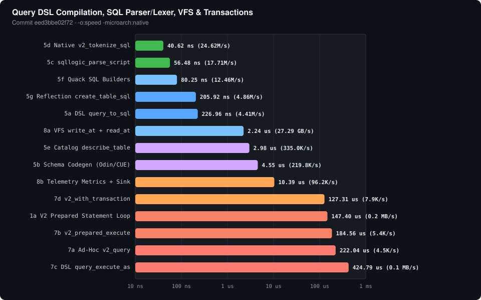

[Root README](../README.md) · **Suite Renders**

# odin-duckdb Benchmarks & Visual Renders

Pure-Odin statistical performance suite for **odin-duckdb** (`48` benchmarks across `8` groups, `336` samples at commit `eed3bbe02f72` in [`history.hugidb`](history.hugidb)), measuring DuckDB 2.0 C API v2 ingestion, zero-copy vector scans, Arrow C Data Interface round-trips, `core:reflect` appenders/unmarshaling, vectorized Odin UDFs, query DSL compilation, VFS I/O, and transactions—with visual SVG charts rendered via [`runa`](https://github.com/boxxxie/runa) under [`renders/`](renders/).

---

## Visual Renders (`-o:speed`)

### 1. Vectorized Ingest vs Zero-Copy Scan & Arrow Bridge (Per-Row Latency)



### 2. Native Child Vectors, Wire Codecs & Vectorized Odin UDFs



### 3. Query DSL Compilation, SQL Parser/Lexer, VFS & Point Transactions



---

## Reproducing & Regenerating Renders

```bash
# 1. Run the full 48-benchmark suite via hugi and append results to benchmarks/history.hugidb
hugi run benchmarks --runs 5 --warmup 1 \
  --extra-build-flags '-microarch:native -extra-linker-flags:"-L/home/pauli/.local/lib -Wl,-rpath,/home/pauli/.local/lib"'

# 2. Selectively run affected benchmarks using git-diff impact mapping (--plan / --affected)
./benchmarks/compare_1v1.py --plan
./benchmarks/compare_1v1.py --affected

# 3. Statistically compare the last two commits (Mann-Whitney U / Welch t-test)
hugi compare --last --db benchmarks/history.hugidb

# 4. Query exported Parquet history directly with DuckDB SQL
hugi export --db benchmarks/history.hugidb --all-commits --out .tmp/history.parquet
duckdb -markdown -light-mode -f benchmarks/query_hugidb.sql

# 5. Regenerate SVG charts in benchmarks/renders/ and tables below using runa AOT templates
odin run benchmarks/render -collection:runa=../runa
```

---

## Full Benchmark Results (`48` Benchmarks at `eed3bbe02f72`)

<!-- BEGIN_BENCHMARK_TABLE -->
### `ingest` — Prepared Loops, Appenders, `append_slice` & Custom `COPY` (`7` benchmarks)

Comparing V1 Appenders, V2 `ColumnDataCollection`, `Struct_Appender(T)`, and custom `V2_Copy_Function` pipelines.

| Benchmark | Median (`p50`) | `P95` | Throughput / Ops | `CV%` | Allocs / op |
| :--- | ---: | ---: | ---: | ---: | ---: |
| `1a. Ingest: V2 Prepared Statement Loop (2K rows)` | **147.40 us** | 154.89 us | 0.2 MB/s | 2.5% | **0** |
| `1b. Ingest: Legacy V1 Appender API (100K rows)` | **166.43 ns** | 187.08 ns | 212.0 MB/s | 10.6% | **0** |
| `1c. Ingest: V2 ColumnDataCollection append_slice (100K rows)` | **124.18 ns** | 307.94 ns | 284.1 MB/s | 65.6% | **0** |
| `1d. Ingest: Nullable Maybe(T) append_slice (100K rows, 25% NULL)` | **117.53 ns** | 261.86 ns | 300.2 MB/s | 51.0% | **0** |
| `1e. Ingest: Custom V2_Copy_Function COPY ... FROM (1M rows)` | **8.32 ns** | 15.65 ns | 1.79 GB/s | 33.7% | **0** |
| `1f. Export: Custom V2_Copy_Function COPY ... TO Sink (1M rows)` | **3.24 ns** | 3.59 ns | 4.60 GB/s | 18.1% | **0** |
| `1g. Ingest: Struct_Appender(T) 1K x 100-Row Micro-Batches (100K)` | **115.55 ns** | 151.94 ns | 305.4 MB/s | 16.2% | **0** |
### `scan` — Zero-Copy Vector Views, Selection Vectors & Arrow Streams (`9` benchmarks)

Zero-copy column views, filtered selection vectors, `core:reflect` unmarshaling, multi-worker scans, and Arrow bridges.

| Benchmark | Median (`p50`) | `P95` | Throughput / Ops | `CV%` | Allocs / op |
| :--- | ---: | ---: | ---: | ---: | ---: |
| `2a. Scan: Zero-Copy V2_Vector_View Flat (1M rows)` | **5.77 ns** | 6.71 ns | 4.04 GB/s | 12.8% | **0** |
| `2b. Scan: Zero-Copy V2_Selection_Vector Filtered (1M source rows)` | **3.81 ns** | 4.03 ns | 6.11 GB/s | 6.2% | **0** |
| `2c. Scan: Arrow C Data Interface Arrow_Array_Stream (1M rows)` | **5.83 ns** | 6.26 ns | 4.00 GB/s | 11.2% | **0** |
| `2d. Unmarshal: core:reflect query_as Non-Null Structs (100K rows)` | **69.91 ns** | 72.85 ns | 504.7 MB/s | 2.4% | **0** |
| `2e. Unmarshal: core:reflect query_as Nullable Maybe(T) (100K rows)` | **91.46 ns** | 100.19 ns | 385.8 MB/s | 4.4% | **0** |
| `2f. Scan: Direct ColumnDataCollection Worker Scan (1M rows)` | **1.05 ns** | 1.35 ns | 14.24 GB/s | 16.8% | **0** |
| `2g. Bridge: Arrow_Exporter -> Arrow_Importer Round-Trip (200K)` | **3.81 ns** | 4.11 ns | 3.91 GB/s | 5.0% | **0** |
| `2h. Scan: Multi-Worker ColumnDataCollection 4-Thread Scan (1M)` | **363.00 ps** | 640.40 ps | 41.05 GB/s | 30.9% | **0** |
| `2i. Scan: Cooperative Stepper v2_step_chunk (1M rows)` | **4.92 ns** | 5.89 ns | 4.73 GB/s | 11.3% | **0** |
### `bytes` — `V2_Bytes`, Casts, Vector Flatten & 128-Bit Codecs (`6` benchmarks)

Inline/arena `V2_Bytes` writes, vector casts, `.OTHER` flattening, zero-copy `vector_reference`, and 128-bit wire codecs.

| Benchmark | Median (`p50`) | `P95` | Throughput / Ops | `CV%` | Allocs / op |
| :--- | ---: | ---: | ---: | ---: | ---: |
| `3a. V2_Bytes Write: Inline <= 12 B (v2_vector_assign_string, 200K)` | **4.79 ns** | 4.88 ns | 2.34 GB/s | 5.0% | **0** |
| `3b. V2_Bytes Write: Arena > 12 B (v2_vector_assign_string, 200K)` | **13.97 ns** | 17.19 ns | 2.13 GB/s | 11.6% | **0** |
| `3c. Vector Cast: duckdb_v2_vector_cast BIGINT -> DOUBLE (200K)` | **299.26 ps** | 307.19 ps | 49.79 GB/s | 1.9% | **0** |
| `3d. Zero-Copy Alias: duckdb_v2_vector_reference (200K rows)` | **6.21 ps** | 7.43 ps | 2.34 TB/s | 10.0% | **0** |
| `3e. Vector Flatten: .OTHER (MakeSequence) -> .FLAT (1M rows)` | **237.44 ps** | 239.86 ps | 31.38 GB/s | 0.8% | **0** |
| `3f. Wire Codec: 128-Bit HUGEINT/INTERVAL/BIT/BIGNUM (200K)` | **1.20 ns** | 1.23 ns | 37.18 GB/s | 1.1% | **0** |
### `nested` — `STRUCT`, `LIST`, `ARRAY`, JSON Tags & Composite Values (`5` benchmarks)

Native nested child vectors (`STRUCT`, `LIST`, `ARRAY`), JSON struct round-trips, and composite value handling.

| Benchmark | Median (`p50`) | `P95` | Throughput / Ops | `CV%` | Allocs / op |
| :--- | ---: | ---: | ---: | ---: | ---: |
| `4a. JSON Tag Round-Trip: append_slice + query_as (10K structs)` | **530.57 ns** | 636.00 ns | 115.0 MB/s | 10.3% | **0** |
| `4b. Native STRUCT(...) Child Vector Write+Read (200K structs)` | **507.10 ps** | 545.42 ps | 45.91 GB/s | 5.4% | **0** |
| `4c. Nested LIST(BIGINT) Vector Write+Read (200K lists / 800K items)` | **730.57 ps** | 878.88 ps | 61.19 GB/s | 10.7% | **0** |
| `4d. Fixed ARRAY(DOUBLE, 4) Vector Write+Read (200K arrays / 800K f64)` | **498.44 ps** | 519.15 ps | 59.79 GB/s | 3.4% | **0** |
| `4e. Composite Values: VARIANT/MAP/UNION/DECIMAL (10K ops)` | **3.60 us** | 3.66 us | 277.4K/s | 1.2% | **0** |
### `dsl_codegen` — Friendly SQL DSL, Codegen, Parser & Native Lexer (`7` benchmarks)

`query_to_sql`, `introspect_table_schema` Odin/CUE codegen, SQLLogic parser, `v2_tokenize_sql`, and Quack helpers.

| Benchmark | Median (`p50`) | `P95` | Throughput / Ops | `CV%` | Allocs / op |
| :--- | ---: | ---: | ---: | ---: | ---: |
| `5a. DSL: query_to_sql Pipeline Compilation (100K queries)` | **226.96 ns** | 228.17 ns | 4.41M/s | 1.0% | **0** |
| `5b. Codegen: introspect_table_schema + Odin/CUE (1K tables)` | **4.55 us** | 4.93 us | 219.8K/s | 4.8% | **0** |
| `5c. Parser: sqllogic_parse_script (50K directives / 1K scripts)` | **56.48 ns** | 71.03 ns | 17.71M/s | 11.3% | **0** |
| `5d. Lexer: Native C API v2 duckdb_v2_tokenize_sql (300K tokens)` | **40.62 ns** | 40.75 ns | 24.62M/s | 0.2% | **0** |
| `5e. Catalog: duckdb_v2_connection_describe_table (5K lookups)` | **2.98 us** | 3.32 us | 335.0K/s | 6.3% | **0** |
| `5f. Quack: SQL Builders + URI Normalize + Template (100K ops)` | **80.25 ns** | 82.72 ns | 12.46M/s | 1.9% | **0** |
| `5g. Reflection DDL: create_table_sql + v2_quote_identifier (100K)` | **205.92 ns** | 210.21 ns | 4.86M/s | 1.7% | **0** |
### `udf` — Vectorized Scalar, Table & Aggregate Odin UDFs (`7` benchmarks)

Vectorized scalar callbacks, streaming table functions with projection/filter pushdown, aggregates, casts, and replacement scans.

| Benchmark | Median (`p50`) | `P95` | Throughput / Ops | `CV%` | Allocs / op |
| :--- | ---: | ---: | ---: | ---: | ---: |
| `6a. UDF: Vectorized Scalar Callback odin_fma (1M rows)` | **952.62 ps** | 1.45 ns | 23.46 GB/s | 24.3% | **0** |
| `6b. UDF: Streaming Table Function odin_gen_series (1M rows)` | **2.39 ns** | 3.76 ns | 6.25 GB/s | 23.1% | **0** |
| `6c. UDF: Grouped Hash Aggregate odin_agg_sum (1M rows)` | **2.35 ns** | 2.88 ns | 3.17 GB/s | 17.1% | **0** |
| `6d. UDF: Table Function Projection + Filter Pushdown (1M rows)` | **443.61 ps** | 461.85 ps | 33.59 GB/s | 2.3% | **0** |
| `6e. UDF: Custom Type & Vectorized V2_Cast_Function (1M rows)` | **687.38 ps** | 884.87 ps | 21.68 GB/s | 13.4% | **0** |
| `6f. UDF: V2_Replacement_Scan Virtual Table Scan (1K queries)` | **268.68 us** | 277.21 us | 3.7K/s | 2.1% | **0** |
| `6g. Extensibility: V2_Pragma + V2_Custom_Option + V2_Macro (1K)` | **68.30 us** | 68.88 us | 14.6K/s | 0.8% | **0** |
### `point_tx` — Point Queries, Prepared Plans & Transactions (`5` benchmarks)

Ad-hoc vs prepared `v2_query` execution, DSL round-trips, and explicit `v2_with_transaction` commits/rollbacks.

| Benchmark | Median (`p50`) | `P95` | Throughput / Ops | `CV%` | Allocs / op |
| :--- | ---: | ---: | ---: | ---: | ---: |
| `7a. Point Lookup: Ad-Hoc v2_query Parse+Bind+Exec (1K queries)` | **222.04 us** | 222.90 us | 4.5K/s | 0.4% | **0** |
| `7b. Point Lookup: Pre-Compiled v2_prepared_execute (1K queries)` | **184.56 us** | 192.03 us | 5.4K/s | 2.0% | **0** |
| `7c. DSL Pipeline: query_execute_as Build+Bind+Unmarshal (1K)` | **424.79 us** | 435.77 us | 0.1 MB/s | 1.9% | **0** |
| `7d. Transactions: v2_with_transaction Commit + Rollback (1K tx)` | **127.31 us** | 131.15 us | 7.9K/s | 1.6% | **0** |
| `7e. Prepared DSL: prepared_query_execute_as Cached Plan+Schema (1K)` | **348.39 us** | 357.97 us | 0.1 MB/s | 1.8% | **0** |
### `vfs_telemetry` — Positional VFS I/O & Query Telemetry (`2` benchmarks)

Positional `write_at` + `read_at` VFS throughput and `V2_Query_Metrics` tree collection.

| Benchmark | Median (`p50`) | `P95` | Throughput / Ops | `CV%` | Allocs / op |
| :--- | ---: | ---: | ---: | ---: | ---: |
| `8a. VFS: Positional write_at + read_at (1K x 64 KB = 64 MB)` | **2.24 us** | 2.24 us | 27.29 GB/s | 0.6% | **0** |
| `8b. Telemetry: V2_Query_Metrics Tree + V2_Log_Sink (10K ops)` | **10.39 us** | 10.54 us | 96.2K/s | 1.2% | **0** |
<!-- END_BENCHMARK_TABLE -->
